# UAT End-to-End — Task A1–A12

Laporan User Acceptance Test untuk halaman **Trails Test Page** (theme `myrehat-test`). Seluruh isi tabel hasil di bawah dibuat otomatis oleh `uat-e2e.js` dari hasil eksekusi Playwright yang sebenarnya.

## Ringkasan

**Hasil: 53 / 53 skenario PASS** — semua acceptance criteria terpenuhi.

| Task | Nama | Skenario | PASS | FAIL | Status |
|---|---|---|---|---|---|
| [A1](#a1--listing-search) | Listing Search | 5 | 5 | 0 | ✅ PASS |
| [A2](#a2--category-filter) | Category Filter | 5 | 5 | 0 | ✅ PASS |
| [A3](#a3--whatsapp--line-sticky-buttons) | WhatsApp & LINE Sticky Buttons | 5 | 5 | 0 | ✅ PASS |
| [A4](#a4--footer-links) | Footer Links | 1 | 1 | 0 | ✅ PASS |
| [A5](#a5--heading) | Heading | 1 | 1 | 0 | ✅ PASS |
| [A6](#a6--digital-nomad-field) | Digital Nomad Field | 5 | 5 | 0 | ✅ PASS |
| [A7](#a7--mobile-390px) | Mobile 390px | 3 | 3 | 0 | ✅ PASS |
| [A8](#a8--social-media-footer) | Social Media Footer | 2 | 2 | 0 | ✅ PASS |
| [A9](#a9--host-terms-checkbox) | Host Terms Checkbox | 4 | 4 | 0 | ✅ PASS |
| [A10](#a10--header-search) | Header Search | 4 | 4 | 0 | ✅ PASS |
| [A11](#a11--daily--monthly-pricing) | Daily / Monthly Pricing | 7 | 7 | 0 | ✅ PASS |
| [A12](#a12--booking-success-confirmation) | Booking Success Confirmation | 9 | 9 | 0 | ✅ PASS |
| [UMUM](#umum--pemeriksaan-umum) | Pemeriksaan Umum | 2 | 2 | 0 | ✅ PASS |

## Lingkungan Pengujian

- Waktu eksekusi: 2026-10-23 08:07 UTC
- URL: `http://127.0.0.1:8770/`
- Browser: Chromium 155.0.8059.86 (headless) via Playwright
- Viewport: desktop 1280×800, mobile 390×844 (emulasi mobile + touch)
- Skenario login (admin bar): dijalankan; pengecekan data tersimpan di server: dijalankan (membaca transient lewat WP_PATH)
- WordPress: 6.8.3 (PHP 8.4), parent theme Hello Elementor, plugin Elementor 4.3.4 aktif, theme `myrehat-test` aktif, halaman "Trails" memakai template `page-trails.php` sebagai front page, menu header 4 item.
- Instalasi WordPress **terpisah** (salinan proyek + SQLite Database Integration) karena database situs ini tidak dapat diakses dari lingkungan pengujian. Kode theme identik dengan repo. Konten produksi (menu, template Elementor, caching) tidak tercakup.

Elemen yang diuji pada screenshot ditandai dengan **garis merah**.

## Cara Menjalankan Ulang

```bash
# WordPress dengan theme ini harus sudah berjalan, misalnya di http://127.0.0.1:8770/
BASE_URL=http://127.0.0.1:8770/ \
WP_USER=<user> WP_PASS=<password> \        # opsional: skenario login/admin bar
WP_PATH=/path/ke/wordpress \               # opsional: cek data booking tersimpan
CHROME_PATH="/Applications/Google Chrome.app/Contents/MacOS/Google Chrome" \  # opsional
PLAYWRIGHT_MODULE=/path/ke/node_modules/playwright \  # jika playwright tidak terpasang lokal
node docs/uat/uat-e2e.js
```

Script menimpa `README.md`, `results.json`, dan isi folder `screenshots/` dengan hasil terbaru. Skenario booking menyimpan data uji (transient `trails_last_booking`) di WordPress target — jangan jalankan terhadap produksi.

## A1 — Listing Search

**Requirement:** Search input memfilter listing secara langsung (judul, lokasi, kategori), tidak case-sensitive, kosong = semua.

| ID | Skenario | Langkah | Expected | Actual | Status |
|---|---|---|---|---|---|
| A1-01 | Search judul "mount" memfilter listing | 1. Buka halaman trails (desktop 1280px)<br>2. Ketik "mount" di kotak "Search trails..." | Hanya 2 trail yang judulnya mengandung "Mount" yang tampil | 2 tampil: Mount Rinjani Sunrise, Mount Kinabalu Base Trek | ✅ PASS |
| A1-02 | Search tidak case-sensitive | 1. Ketik "MOUNT" (huruf besar) | Hasil sama dengan "mount" (2 trail) | 2 tampil: Mount Rinjani Sunrise, Mount Kinabalu Base Trek | ✅ PASS |
| A1-03 | Search berdasarkan lokasi | 1. Ketik "Sabah" | Mount Kinabalu Base Trek (lokasi Sabah) tampil | 1 tampil: Mount Kinabalu Base Trek | ✅ PASS |
| A1-04 | Search tanpa hasil menampilkan pesan kosong | 1. Ketik "zzzz" | Tidak ada trail tampil; pesan "No trails found." muncul | 0 tampil, pesan kosong tampil | ✅ PASS |
| A1-05 | Search dikosongkan menampilkan semua listing | 1. Hapus isi kotak search | Semua 6 trail tampil kembali; pesan kosong hilang | 6 tampil, pesan kosong hilang | ✅ PASS |

**Bukti screenshot:**

- A1-01 — `A1-01-search-mount.png`

  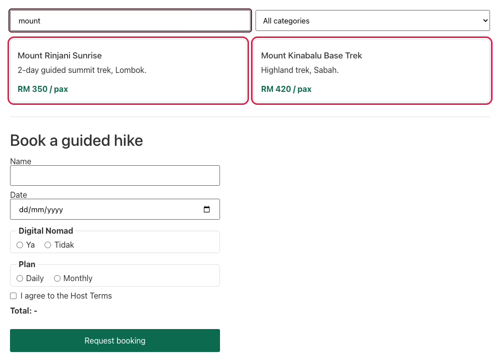

- A1-04 — `A1-04-search-no-results.png`

  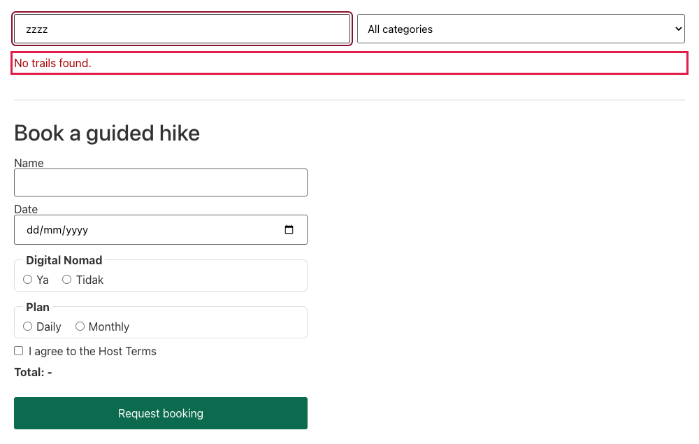


**Catatan:**

- Root cause: `trails.js` memakai selector `#searchInput` (seharusnya `#search-box`) sehingga script berhenti dengan TypeError; selector pesan kosong juga salah (`#no-results` → `#trails-no-results`).
- Teks yang dicari: teks kartu (judul, lokasi, harga) + `data-category`. Spasi di awal/akhir query diabaikan.

## A2 — Category Filter

**Requirement:** Dropdown kategori memfilter listing dan digabung dengan search (`visible = matchesSearch && matchesCategory`).

| ID | Skenario | Langkah | Expected | Actual | Status |
|---|---|---|---|---|---|
| A2-01 | Filter kategori Beach | 1. Pilih kategori "Beach" | Hanya trail kategori beach (2) yang tampil | 2 tampil: Pulau Perhentian Coastal Walk, Langkawi Sunset Ridge | ✅ PASS |
| A2-02 | Kombinasi search + kategori | 1. Kategori tetap "Beach"<br>2. Ketik "sunset" | Hanya trail yang memenuhi kedua kondisi tampil (Langkawi Sunset Ridge) | 1 tampil: Langkawi Sunset Ridge | ✅ PASS |
| A2-03 | Kombinasi yang bertentangan | 1. Ketik "mount"<br>2. Kategori "Beach" | Tidak ada hasil; pesan "No trails found." muncul | 0 tampil, pesan kosong tampil | ✅ PASS |
| A2-04 | "All categories" mengikuti search aktif | 1. Search tetap "mount"<br>2. Pilih "All categories" | Hasil sesuai search saja (2 trail Mount) | 2 tampil: Mount Rinjani Sunrise, Mount Kinabalu Base Trek | ✅ PASS |
| A2-05 | Semua kategori dapat dipilih | 1. Pilih Mountain, Beach, Forest bergantian dengan search kosong | Masing-masing menampilkan 2 trail sesuai kategorinya | mountain=2, beach=2, forest=2 | ✅ PASS |

**Bukti screenshot:**

- A2-01 — `A2-01-category-beach.png`

  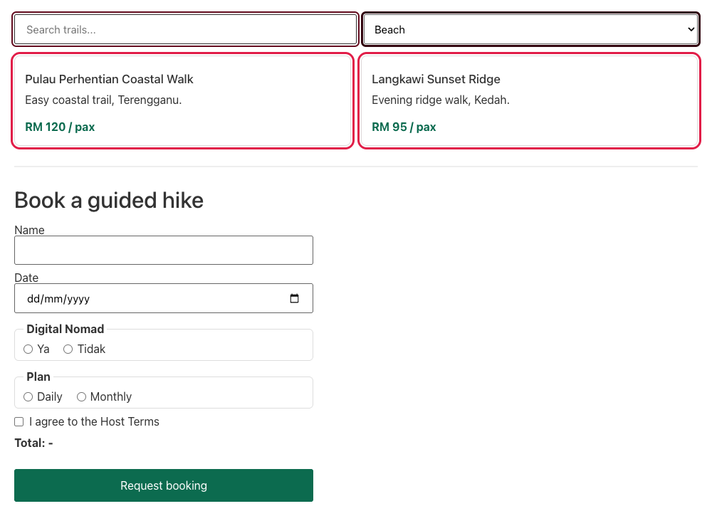

- A2-02 — `A2-02-search-plus-category.png`

  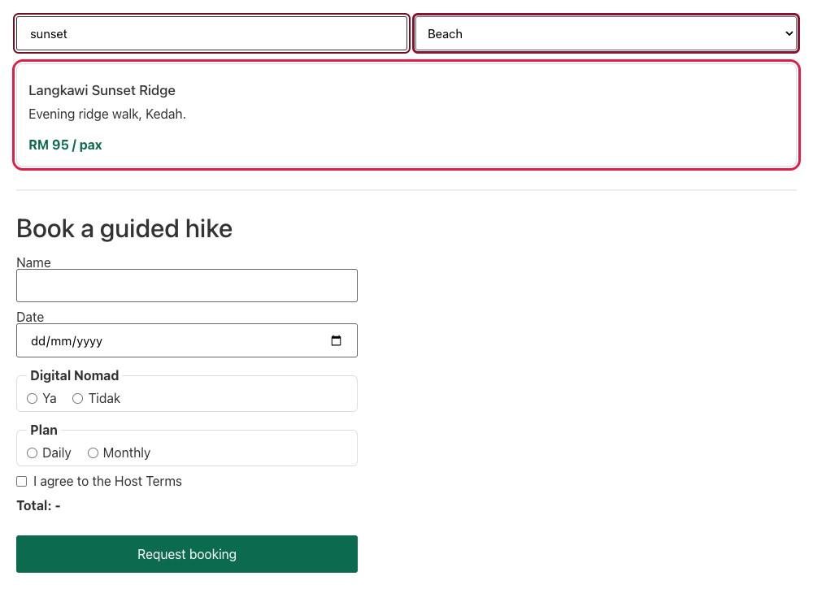


**Catatan:**

- Satu fungsi `filterTrails()` dipakai bersama oleh search, header search, dan kategori — tidak ada mekanisme filter ganda.
- Contoh di brief (`beach` + `family`) tidak dapat diuji karena kategori "family" tidak ada di markup; kategori yang tersedia: Mountain, Beach, Forest.

## A3 — WhatsApp & LINE Sticky Buttons

**Requirement:** Dua tombol di area atas, sticky, bold, responsif, tidak menutup navigasi, tanpa overflow.

| ID | Skenario | Langkah | Expected | Actual | Status |
|---|---|---|---|---|---|
| A3-01 | Tombol WhatsApp & LINE tampil di atas, bold | 1. Buka halaman (desktop)<br>2. Lihat area atas halaman | Dua tombol WhatsApp dan LINE terlihat jelas, teks bold, di bawah navigasi utama | WhatsApp & LINE, font-weight 700/700, bar di y=80 (nav berakhir y=80) | ✅ PASS |
| A3-02 | Tombol sticky saat halaman di-scroll | 1. Scroll ke bawah 900px | Bar tombol tetap menempel di atas viewport dan tidak tertutup konten | posisi bar top=0px setelah scroll; tombol tidak tertutup | ✅ PASS |
| A3-03 | Link WhatsApp & LINE | 1. Periksa tujuan tombol WhatsApp<br>2. Klik WhatsApp<br>3. Periksa tombol LINE | WhatsApp → wa.me/6282252081212 di tab baru; LINE tampil sebagai label (URL belum tersedia) | WhatsApp href=https://wa.me/6282252081212 (target=_blank); tab baru membuka https://api.whatsapp.com/send/?phone=6282252081212&text&type=phone_num; LINE = <span> tanpa href | ✅ PASS |
| A3-04 | Mobile 390px: tombol sticky & menu tetap bisa dipakai | 1. Lihat bagian atas di 390px<br>2. Buka menu hamburger<br>3. Scroll ke bawah | Tombol tampil tanpa overflow; dropdown menu tidak tertutup tombol; tombol menempel di atas saat scroll | tombol muat di layar: true; menu dropdown dapat diklik: true; top bar saat scroll: 0px | ✅ PASS |
| A3-05 | Login (admin bar): tombol sticky tidak tertutup admin bar | 1. Login ke WordPress<br>2. Buka halaman, scroll ke bawah | Bar tombol menempel tepat di bawah admin bar (32px) | admin bar: ada; top bar saat scroll: 32px | ✅ PASS |

**Bukti screenshot:**

- A3-01 — `A3-01-buttons-desktop-top.png`

  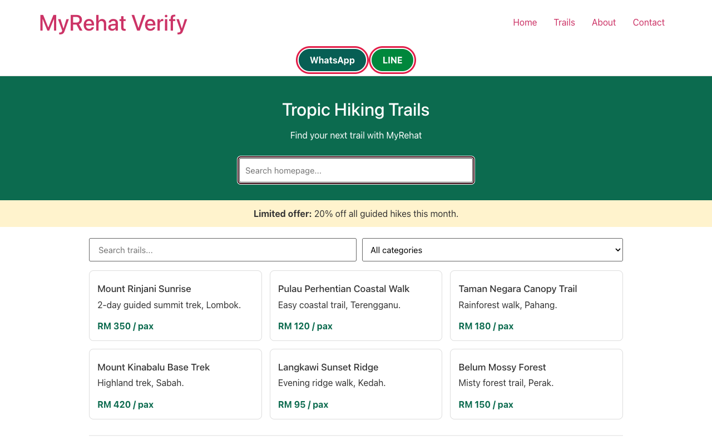

- A3-02 — `A3-02-buttons-desktop-sticky.png`

  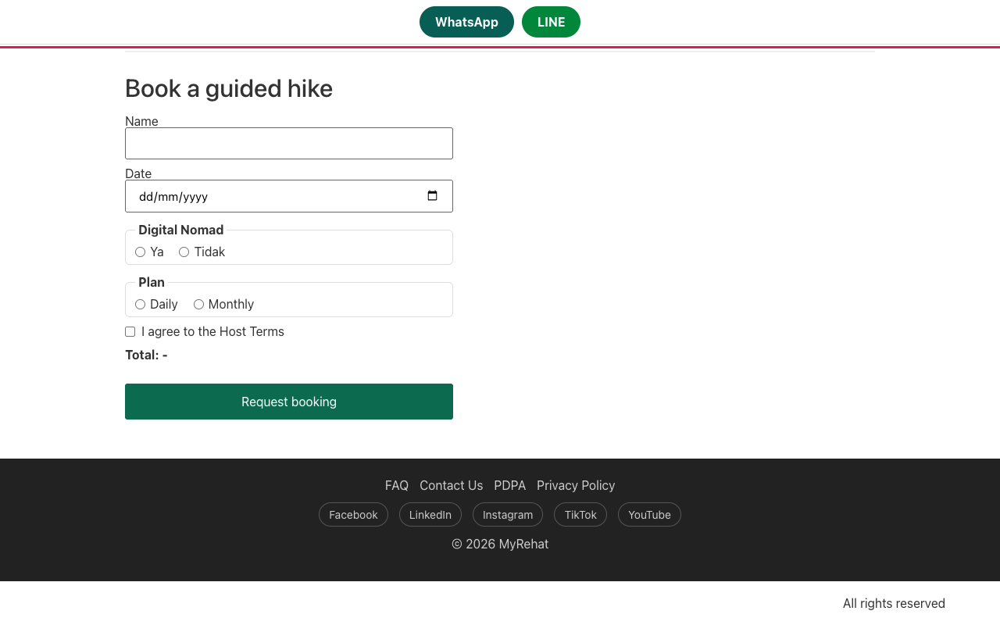

- A3-04 — `A3-04a-buttons-mobile-top.png`

  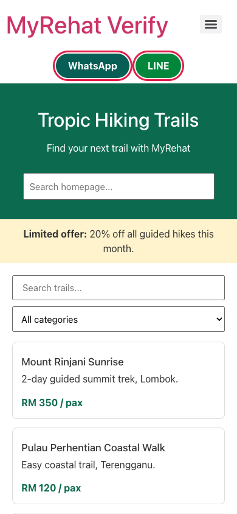

- A3-04 — `A3-04b-mobile-menu-open.png`

  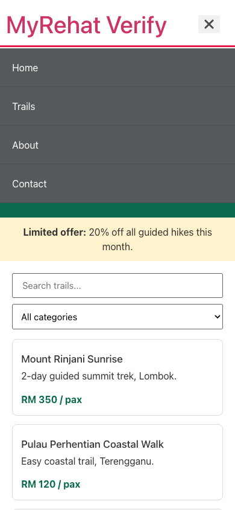

- A3-04 — `A3-04c-buttons-mobile-sticky.png`

  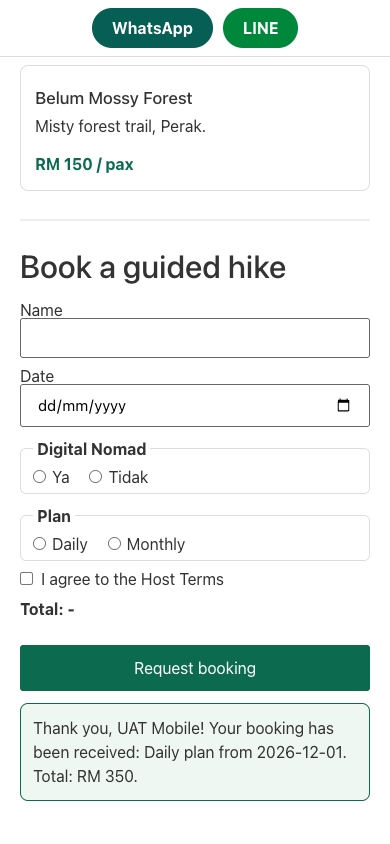

- A3-05 — `A3-05-logged-in-admin-bar-sticky.png`

  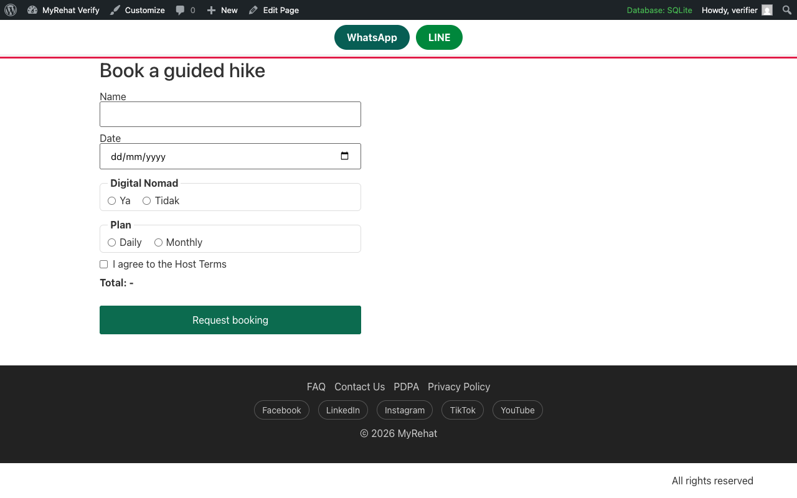


**Catatan:**

- WhatsApp memakai nomor 082252081212 dalam format internasional `https://wa.me/6282252081212` (diasumsikan nomor Indonesia, prefix 0822).
- **LINE belum memiliki URL** sehingga tampil sebagai label (bukan link). Tambahkan lewat filter `myrehat_test_line_url` saat URL tersedia.
- Saat login, bar menempel tepat di bawah admin bar WordPress (32px); di ≤600px admin bar tidak fixed sehingga bar menempel di 0.
- Di mobile, menu header Hello Elementor berupa hamburger; dropdown-nya berada di atas bar tombol (tidak tertutup).

## A4 — Footer Links

**Requirement:** Kelompok link navigasi footer hanya FAQ, Contact Us, PDPA, Privacy Policy.

| ID | Skenario | Langkah | Expected | Actual | Status |
|---|---|---|---|---|---|
| A4-01 | Footer navigation hanya 4 link | 1. Scroll ke footer<br>2. Periksa kelompok link navigasi | Hanya FAQ, Contact Us, PDPA, Privacy Policy (tanpa Twitter / link lain) | FAQ, Contact Us, PDPA, Privacy Policy; Twitter di halaman: tidak ada | ✅ PASS |

**Bukti screenshot:**

- A4-01 — `A4-01-footer-links.png`

  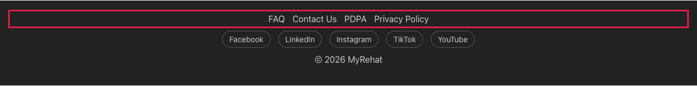


**Catatan:**

- Dihapus: Blog, Careers, Terms of Service, Sitemap, Twitter; "Privacy Policy Statement" diganti menjadi "Privacy Policy".
- Tujuan link masih placeholder `#` (sudah begitu sebelumnya). Menu footer WordPress dari database produksi (jika ada) tidak tercakup UAT ini.

## A5 — Heading

**Requirement:** Judul tampil persis "Tropic Hiking Trails".

| ID | Skenario | Langkah | Expected | Actual | Status |
|---|---|---|---|---|---|
| A5-01 | Judul halaman tepat | 1. Lihat heading utama halaman | Teks persis "Tropic Hiking Trails" | h1 = ["Tropic Hiking Trails"] | ✅ PASS |

**Bukti screenshot:**

- A5-01 — `A5-01-heading.png`

  


**Catatan:**

- Sebelumnya hardcoded "Hiking Advantures". Judul tab browser (`<title>`) berasal dari judul halaman di WP Admin, bukan dari template.

## A6 — Digital Nomad Field

**Requirement:** Field wajib "Digital Nomad" dengan pilihan Ya/Tidak; server hanya menerima `Ya` atau `Tidak`.

| ID | Skenario | Langkah | Expected | Actual | Status |
|---|---|---|---|---|---|
| A6-01 | Field Digital Nomad tampil dengan pilihan Ya/Tidak | 1. Scroll ke form booking<br>2. Periksa field "Digital Nomad" | Label "Digital Nomad", pilihan Ya dan Tidak, wajib diisi | legend "Digital Nomad", opsi: Ya (required), Tidak (required) | ✅ PASS |
| A6-02 | Ya dan Tidak dapat dipilih | 1. Klik label "Ya"<br>2. Klik label "Tidak" | Masing-masing dapat dipilih dan saling eksklusif | Ya terpilih: true; Tidak terpilih & Ya lepas: true | ✅ PASS |
| A6-03 | Submit tanpa memilih Digital Nomad ditolak | 1. Isi Name, Date, Plan, centang Host Terms<br>2. Jangan pilih Digital Nomad<br>3. Klik "Request booking" | Browser menolak submit dan meminta memilih opsi; tidak ada request ke server | request POST: 0; pesan browser: "Please select one of these options." | ✅ PASS |
| A6-04 | Server menolak nilai Digital Nomad selain Ya/Tidak ("Maybe") | 1. Kirim POST langsung ke server dengan nonce halaman<br>2. Field: booking_name=UAT API, date=2026-12-02, digital_nomad=Maybe, plan=daily, host_terms=1 | HTTP 400, success=false, pesan mengandung "Digital Nomad" | HTTP 400, success=false: Your booking was not sent. Please fix the following: / Please choose Ya or Tidak for Digital Nomad. | ✅ PASS |
| A6-05 | Server menolak Digital Nomad kosong | 1. Kirim POST langsung ke server dengan nonce halaman<br>2. Field: booking_name=UAT API, date=2026-12-02, plan=daily, host_terms=1 | HTTP 400, success=false, pesan mengandung "Digital Nomad" | HTTP 400, success=false: Your booking was not sent. Please fix the following: / Please choose Ya or Tidak for Digital Nomad. | ✅ PASS |

**Bukti screenshot:**

- A6-01 — `A6-01-digital-nomad-field.png`

  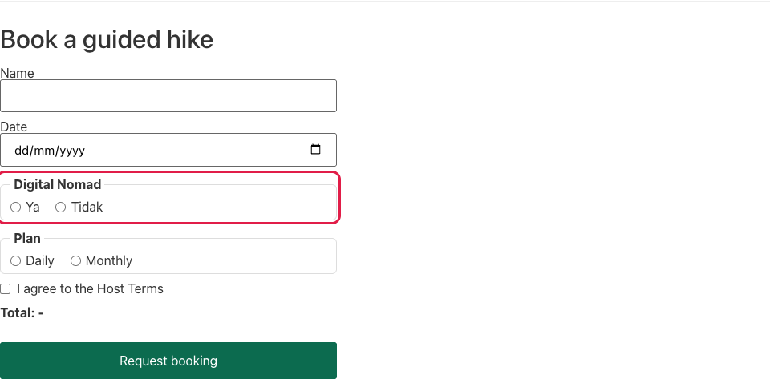


**Catatan:**

- Validasi dua lapis: `required` di browser dan whitelist ketat di server (`myrehat_test_validate_booking`).
- Pesan validasi browser (A6-03) adalah tooltip native browser sehingga tidak terekam di screenshot; teksnya dicatat di kolom Actual.

## A7 — Mobile 390px

**Requirement:** Di 390px semua section tampil, tidak ada scroll horizontal, form & CTA dapat dipakai.

| ID | Skenario | Langkah | Expected | Actual | Status |
|---|---|---|---|---|---|
| A7-01 | Mobile 390px: tidak ada scroll horizontal | 1. Buka halaman di viewport 390px<br>2. Coba geser halaman ke kanan | Lebar halaman = 390px; halaman tidak bisa digeser horizontal; tidak ada elemen keluar viewport | scrollWidth 390px / viewport 390px; scrollX setelah digeser: 0; elemen keluar viewport: 0 | ✅ PASS |
| A7-02 | Mobile 390px: semua section tampil | 1. Periksa section utama satu per satu | Contact bar, header, promo, search, listing, form booking, footer semuanya tampil | Contact bar: tampil; Header: tampil; Promo: tampil; Search & kategori: tampil; Listing: tampil; Form booking: tampil; Footer: tampil | ✅ PASS |
| A7-03 | Mobile 390px: form & CTA dapat dipakai | 1. Isi form booking di 390px dan submit | Semua field di dalam viewport; booking berhasil | form berakhir di x=370px; pesan: "Thank you, UAT Mobile! Your booking has been received: Daily plan from 2026-12-01. Total: RM 350." | ✅ PASS |

**Bukti screenshot:**

- A7-01 — `A7-01-mobile-390-fullpage.png`

  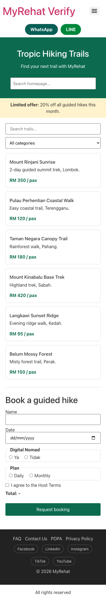

- A7-02 — `A7-02-mobile-promo-visible.png`

  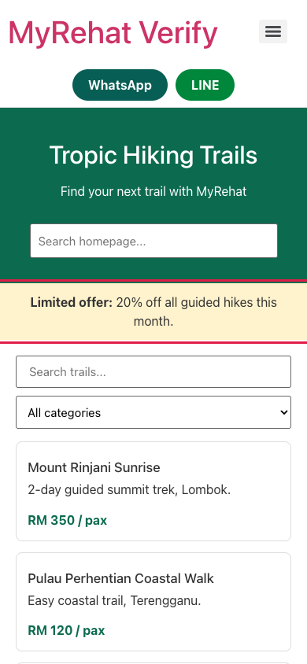

- A7-03 — `A7-03-mobile-booking-success.png`

  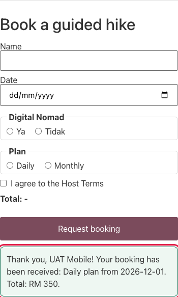


**Catatan:**

- Root cause overflow: `.trail-card { min-width: 320px }` di flex row tanpa wrap (halaman ±2010px di 390px; desktop juga overflow). Diganti `flex-wrap: wrap` + `flex: 1 1 260px`.
- Root cause section hilang: `.trails-promo { display: none }` di media query ≤600px — dihapus.
- Tidak memakai `overflow-x: hidden` sebagai solusi.

## A8 — Social Media Footer

**Requirement:** Footer menampilkan Facebook, LinkedIn, Instagram, TikTok, YouTube dengan label aksesibel, rapi, responsif.

| ID | Skenario | Langkah | Expected | Actual | Status |
|---|---|---|---|---|---|
| A8-01 | Social media footer lengkap | 1. Lihat footer<br>2. Periksa label & tujuan link social | Facebook, LinkedIn, Instagram, TikTok, YouTube tampil dengan link (dummy "task14"), aria-label tersedia | Facebook → https://www.facebook.com/task14; LinkedIn → https://www.linkedin.com/company/task14; Instagram → https://www.instagram.com/task14; TikTok → https://www.tiktok.com/@task14; YouTube → https://www.youtube.com/@task14; aria-label="Social media" | ✅ PASS |
| A8-02 | Mobile 390px: footer social rapi tanpa overflow | 1. Scroll ke footer di 390px | Semua item social terlihat, membungkus ke baris berikutnya bila perlu, tidak keluar layar | 5 item, posisi kanan maks 339px | ✅ PASS |

**Bukti screenshot:**

- A8-01 — `A8-01-footer-social-desktop.png`

  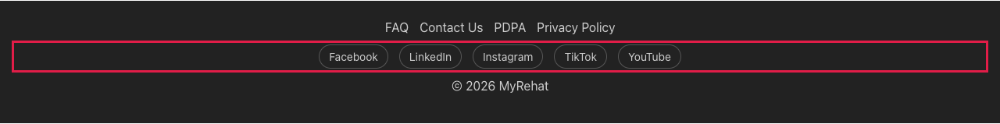

- A8-02 — `A8-02-footer-social-mobile.png`

  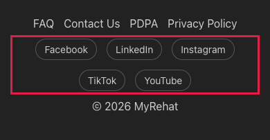


**Catatan:**

- **URL social media adalah dummy "task14"** sesuai permintaan; ganti di `myrehat_test_set_social_urls()` saat akun resmi tersedia.
- Memakai label teks (konsisten dengan gaya link footer yang ada); link dibuka di tab baru dengan `rel="noopener"`.

## A9 — Host Terms Checkbox

**Requirement:** Checkbox wajib "I agree to the Host Terms"; submit gagal jika tidak dicentang, divalidasi juga di server.

| ID | Skenario | Langkah | Expected | Actual | Status |
|---|---|---|---|---|---|
| A9-01 | Checkbox Host Terms tampil dengan label persis | 1. Periksa checkbox persetujuan | Label persis "I agree to the Host Terms", wajib dicentang | label "I agree to the Host Terms", required=true | ✅ PASS |
| A9-02 | Submit tanpa centang Host Terms ditolak | 1. Isi semua field, pilih Digital Nomad<br>2. Jangan centang Host Terms<br>3. Klik "Request booking" | Browser menolak submit; tidak ada request ke server | request POST: 0; pesan browser: "Please check this box if you want to proceed." | ✅ PASS |
| A9-03 | Server menolak booking tanpa persetujuan Host Terms | 1. Kirim POST langsung ke server dengan nonce halaman<br>2. Field: booking_name=UAT API, date=2026-12-02, digital_nomad=Ya, plan=daily | HTTP 400, success=false, pesan mengandung "Host Terms" | HTTP 400, success=false: Your booking was not sent. Please fix the following: / You must agree to the Host Terms to request a booking. | ✅ PASS |
| A9-04 | Server menolak nilai persetujuan palsu ("on") | 1. Kirim POST langsung ke server dengan nonce halaman<br>2. Field: booking_name=UAT API, date=2026-12-02, digital_nomad=Ya, plan=daily, host_terms=on | HTTP 400, success=false, pesan mengandung "Host Terms" | HTTP 400, success=false: Your booking was not sent. Please fix the following: / You must agree to the Host Terms to request a booking. | ✅ PASS |

**Bukti screenshot:**

- A9-01 — `A9-01-host-terms-checkbox.png`

  


**Catatan:**

- Server hanya menerima nilai checkbox `"1"`; nilai lain (`on`, `true`, `yes`, kosong) ditolak dengan pesan jelas.
- Belum ada halaman Host Terms, sehingga teks belum menjadi link.

## A10 — Header Search

**Requirement:** Search di header memfilter listing yang sama dengan A1, tanpa logika filter baru.

| ID | Skenario | Langkah | Expected | Actual | Status |
|---|---|---|---|---|---|
| A10-01 | Header search memfilter listing yang sama | 1. Ketik "kinabalu" di kotak search header ("Search homepage...") | Listing terfilter; kotak search listing ikut berisi "kinabalu" | 1 tampil (Mount Kinabalu Base Trek); kotak listing = "kinabalu" | ✅ PASS |
| A10-02 | Kotak search listing sinkron balik ke header | 1. Ketik "perak" di kotak search listing | Header berisi "perak"; listing terfilter (1 trail) | 1 tampil; header = "perak" | ✅ PASS |
| A10-03 | Header search + kategori | 1. Ketik "mount" di header<br>2. Pilih kategori "Mountain", lalu "Beach" | Mountain → 2 trail; Beach → 0 dengan pesan kosong | Mountain=2, Beach=0, pesan kosong tampil | ✅ PASS |
| A10-04 | Tidak ada listener ganda | 1. Periksa event listener pada #main-search, #search-box, #category (Chrome DevTools Protocol) | Masing-masing tepat 1 listener | #main-search: input; #search-box: input; #category: change | ✅ PASS |

**Bukti screenshot:**

- A10-01 — `A10-01-header-search.png`

  

- A10-01 — `A10-01-header-search-listing.png`

  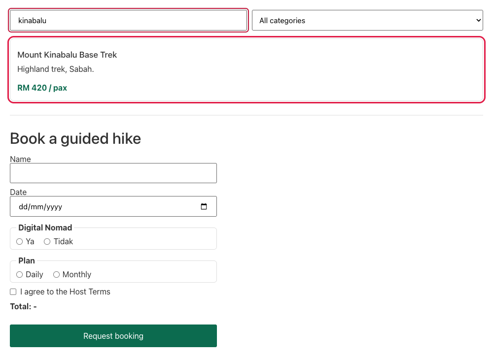


**Catatan:**

- Kedua kotak search merepresentasikan satu query yang sama dan selalu disinkronkan; kategori tetap ikut diterapkan.
- Placeholder header masih "Search homepage..." (tidak diubah karena tidak diminta); "Search trails..." akan lebih jelas.

## A11 — Daily / Monthly Pricing

**Requirement:** Pilihan Daily (RM 350) / Monthly (RM 350 × 30 × 0.8 = RM 8,400), total update langsung, server menentukan harga.

| ID | Skenario | Langkah | Expected | Actual | Status |
|---|---|---|---|---|---|
| A11-01 | Plan Daily → total RM 350 | 1. Pilih plan "Daily" | Total berubah langsung menjadi "Total: RM 350" | Total: RM 350 | ✅ PASS |
| A11-02 | Plan Monthly → total RM 8,400 | 1. Pilih plan "Monthly" | Total berubah langsung menjadi "Total: RM 8,400" (350 × 30 × 0.8) | Total: RM 8,400; reload halaman: tidak | ✅ PASS |
| A11-03 | Harga tidak bergantung pada trail | 1. Plan Monthly tetap terpilih<br>2. Filter listing ke "kinabalu" lalu ke kategori lain | Total tetap RM 8,400 | setelah search: Total: RM 8,400; setelah kategori: Total: RM 8,400 | ✅ PASS |
| A11-04 | Submit tanpa memilih plan ditolak | 1. Reset form, isi field lain, jangan pilih plan<br>2. Klik "Request booking" | Browser menolak submit; total tetap "Total: -" | pesan browser: "Please select one of these options." | ✅ PASS |
| A11-05 | Harga dimanipulasi di browser tetap dihitung server | 1. Pilih Monthly<br>2. Ubah data-price di browser menjadi 1 (tampilan jadi RM 1)<br>3. Submit booking | Server tetap mengenakan RM 8,400 dan pesan sukses menampilkan RM 8,400 | tampilan browser "Total: RM 1"; pesan server: "Thank you, UAT Tamper! Your booking has been received: Monthly plan from 2026-12-01. Total: RM 8,400."; harga tersimpan: 8400 | ✅ PASS |
| A11-06 | Server menolak plan tidak dikenal ("weekly") | 1. Kirim POST langsung ke server dengan nonce halaman<br>2. Field: booking_name=UAT API, date=2026-12-02, digital_nomad=Ya, plan=weekly, host_terms=1 | HTTP 400, success=false, pesan mengandung "Daily or Monthly" | HTTP 400, success=false: Your booking was not sent. Please fix the following: / Please choose a Daily or Monthly plan. | ✅ PASS |
| A11-07 | Server mengabaikan field price/total dari browser | 1. Kirim POST plan=monthly dengan price=1 dan total=1 | HTTP 200; pesan menampilkan RM 8,400 | HTTP 200: Thank you, UAT API! Your booking has been received: Monthly plan from 2026-12-02. Total: RM 8,400. | ✅ PASS |

**Bukti screenshot:**

- A11-01 — `A11-01-plan-daily.png`

  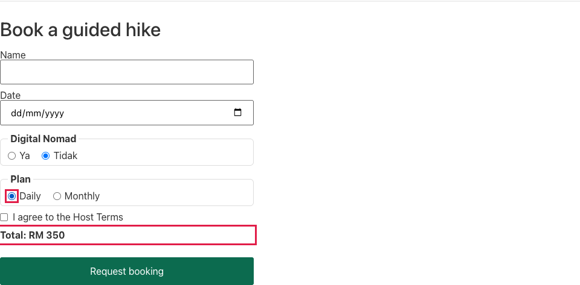

- A11-02 — `A11-02-plan-monthly.png`

  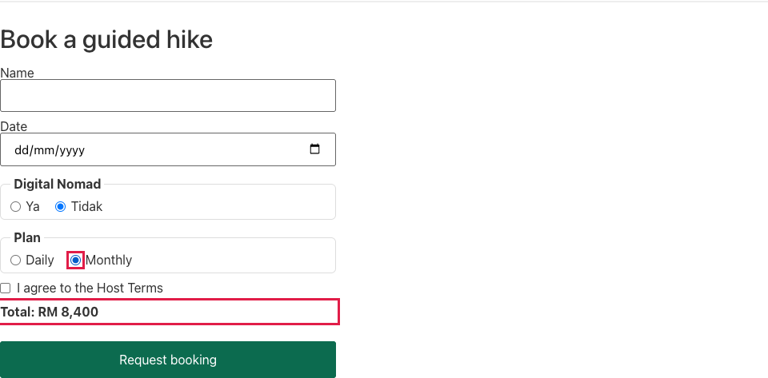

- A11-05 — `A11-05a-tampered-ui-total.png`

  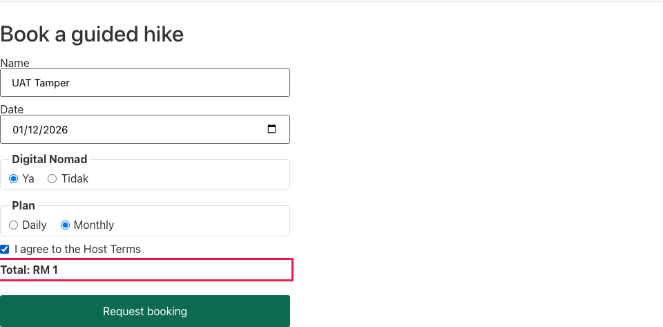

- A11-05 — `A11-05b-server-price-wins.png`

  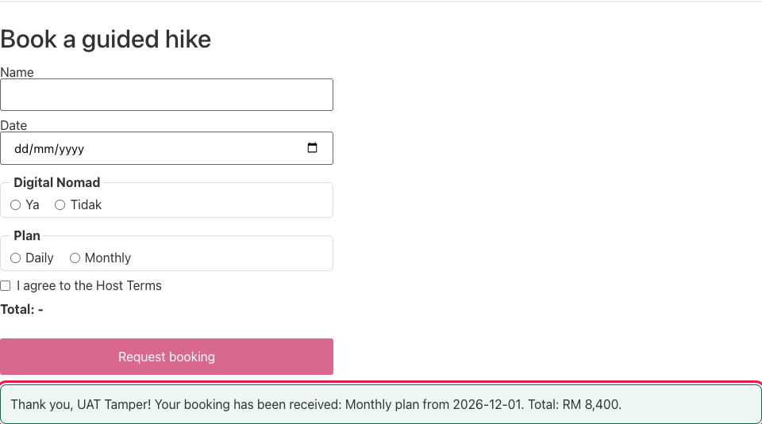


**Catatan:**

- Harga dihitung di PHP (`myrehat_test_booking_plans()`); browser hanya menampilkan. Nilai harga dari browser diabaikan server (A11-05, A11-07).
- Tidak ada default plan; total menampilkan "Total: -" sampai plan dipilih.

## A12 — Booking Success Confirmation

**Requirement:** Pesan sukses hanya tampil jika server menyatakan booking berhasil; error ditampilkan dengan benar; cegah submit ganda.

| ID | Skenario | Langkah | Expected | Actual | Status |
|---|---|---|---|---|---|
| A12-01 | Booking valid → pesan sukses otomatis | 1. Isi Name "UAT Tester", Date 2026-12-01, Digital Nomad "Ya", Plan "Monthly", centang Host Terms<br>2. Klik "Request booking" | Server menjawab sukses; pesan konfirmasi tampil otomatis dengan total RM 8,400; form di-reset; booking tersimpan di server | HTTP 200 success=true; pesan: "Thank you, UAT Tester! Your booking has been received: Monthly plan from 2026-12-01. Total: RM 8,400."; form reset: true; data tersimpan: {"name":"UAT Tester","date":"2026-12-01","digital_nomad":"Ya","plan":"monthly","price":8400,"host_terms":true} | ✅ PASS |
| A12-02 | Tidak ada popup alert palsu | 1. Amati selama submit A12-01 | Tidak ada alert() — konfirmasi hanya di halaman | jumlah alert: 0 | ✅ PASS |
| A12-03 | Booking ditolak server → pesan error, tanpa sukses | 1. Simulasikan klien yang melewati validasi browser (atribut required dihapus)<br>2. Kosongkan semua field, klik "Request booking" | Pesan error merah berisi daftar kesalahan per field; pesan sukses tidak tampil; tidak ada data tersimpan | class=is-error; pesan: "Your booking was not sent. Please fix the following: · Please enter your name. · Please choose a valid date. · Please choose Ya or Tidak for Digital Nomad. · Please choose a Daily or Monthly plan. · You must agree to the Host Terms to request a booking."; data server berubah: false | ✅ PASS |
| A12-04 | Koneksi gagal → pesan error | 1. Isi form valid<br>2. Putuskan request ke server (simulasi jaringan gagal)<br>3. Klik "Request booking" | Pesan error koneksi tampil; tidak ada pesan sukses; tombol aktif kembali | class=is-error; pesan: "Could not reach the server. Please check your connection and try again."; tombol aktif: true | ✅ PASS |
| A12-05 | Mencegah submit ganda | 1. Isi form valid<br>2. Klik "Request booking" lalu submit lagi 2× selagi request berjalan (server diperlambat 800ms) | Hanya 1 request terkirim; tombol nonaktif selama proses | request POST: 1; tombol nonaktif saat proses: true; hasil: is-success | ✅ PASS |
| A12-06 | Server menolak nonce palsu | 1. Kirim POST langsung ke server dengan nonce halaman<br>2. Field: trails_booking_nonce=forged0000, booking_name=UAT API, date=2026-12-02, digital_nomad=Ya, plan=daily, host_terms=1 | HTTP 400, success=false, pesan mengandung "session has expired" | HTTP 400, success=false: Your session has expired. Please reload the page and try again. | ✅ PASS |
| A12-07 | Server menolak tanggal tidak valid (2026-02-30) | 1. Kirim POST langsung ke server dengan nonce halaman<br>2. Field: booking_name=UAT API, date=2026-02-30, digital_nomad=Ya, plan=daily, host_terms=1 | HTTP 400, success=false, pesan mengandung "valid date" | HTTP 400, success=false: Your booking was not sent. Please fix the following: / Please choose a valid date. | ✅ PASS |
| A12-08 | Tanpa JavaScript: booking tetap berjalan | 1. Nonaktifkan JavaScript<br>2. Isi form valid dan submit | Halaman memuat ulang dengan pesan sukses dari server | pesan: "Thank you, UAT NoJS! Your booking has been received: Monthly plan from 2026-12-01. Total: RM 8,400." | ✅ PASS |
| A12-09 | Pesan sukses tidak bisa dipalsukan lewat URL | 1. Buka halaman dengan ?booking=success | Tidak ada pesan sukses yang tampil | kotak konfirmasi tersembunyi | ✅ PASS |

**Bukti screenshot:**

- A12-01 — `A12-01a-form-filled.png`

  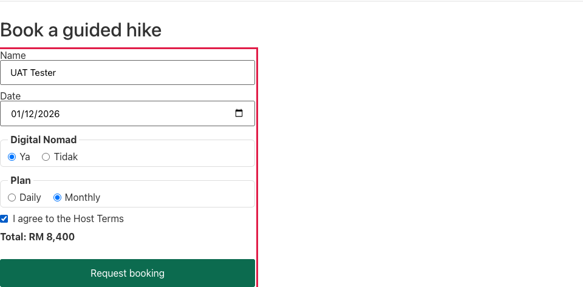

- A12-01 — `A12-01b-success-message.png`

  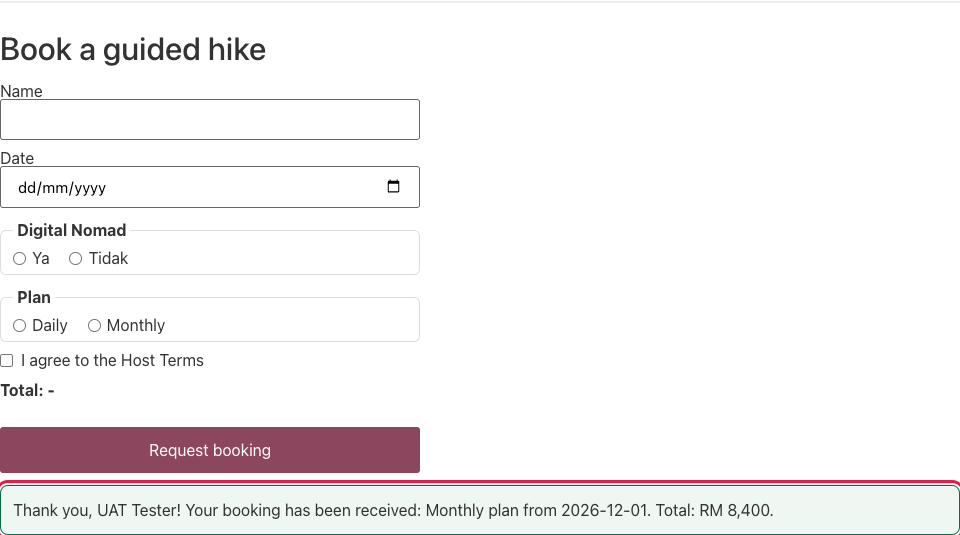

- A12-03 — `A12-03-server-validation-error.png`

  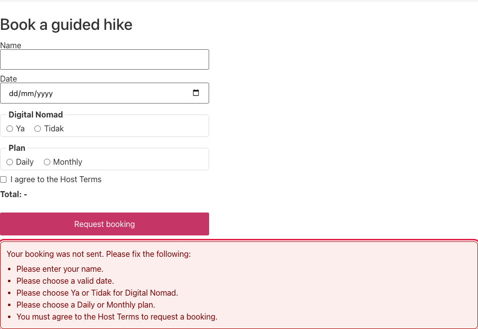

- A12-04 — `A12-04-network-error.png`

  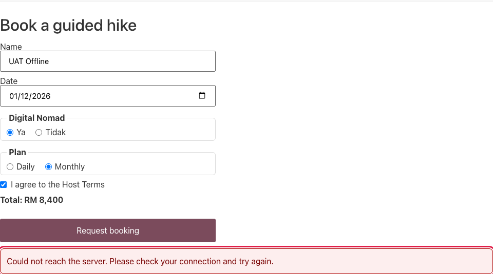

- A12-05 — `A12-05-button-disabled-while-sending.png`

  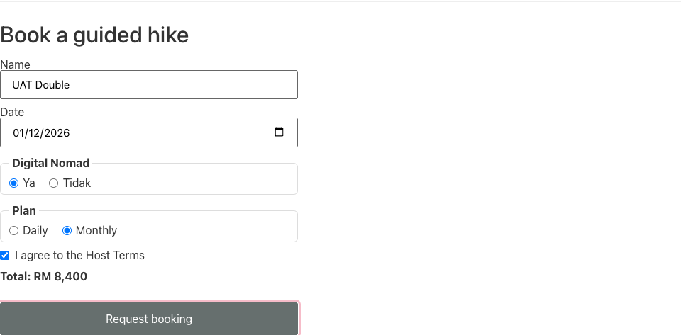

- A12-08 — `A12-08-no-js-success.png`

  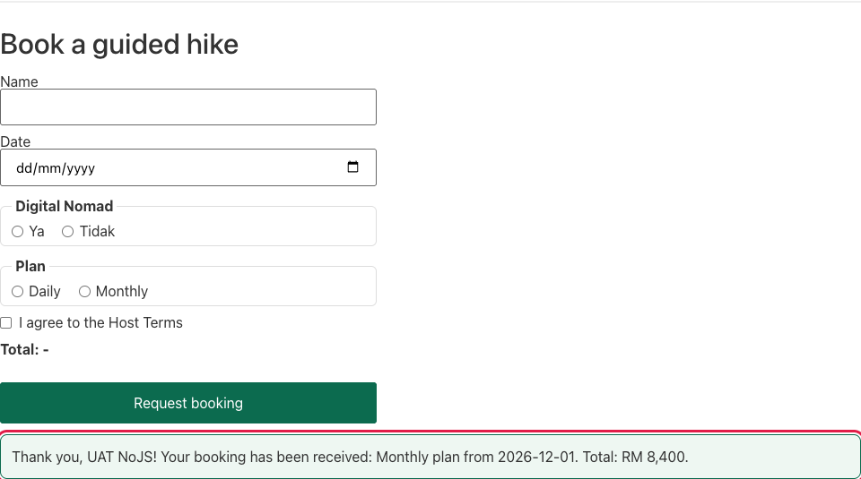


**Catatan:**

- Root cause: konfirmasi sebelumnya adalah `alert()` palsu tanpa request ke server; form tidak pernah sampai ke handler.
- Temuan saat final verification di WordPress asli: field `name` bentrok dengan query var publik WordPress (respons jadi 404). Field diganti `booking_name`; respons sukses selalu HTTP 200.
- Penyimpanan booking masih transient tunggal (`trails_last_booking`, 1 jam) sesuai arsitektur awal — untuk produksi perlu penyimpanan permanen.
- Jika halaman di-cache penuh untuk pengunjung anonim, umur cache harus lebih pendek dari umur nonce (12–24 jam).

## UMUM — Pemeriksaan Umum

**Requirement:** Tidak ada error JavaScript baru di halaman trails maupun halaman lain.

| ID | Skenario | Langkah | Expected | Actual | Status |
|---|---|---|---|---|---|
| G-01 | Tidak ada error JavaScript di halaman trails | 1. Kumpulkan error console selama skenario desktop & mobile | Tidak ada error JS (respons 400 dari skenario penolakan server dan koneksi gagal A12-04 sengaja dipicu, sehingga dikecualikan) | tidak ada error | ✅ PASS |
| G-02 | Halaman lain (tanpa listing/form) tidak error | 1. Buka halaman post biasa (/?p=1) yang tetap memuat trails.js | Tidak ada error JavaScript | trails.js dimuat: true; error: tidak ada | ✅ PASS |

## Catatan Umum & Tindak Lanjut

- **Data final yang masih dibutuhkan:** URL LINE; URL social media resmi (saat ini dummy "task14").
- **Perlu dicek di lingkungan produksi:** menu/template Elementor dari database produksi, caching halaman, dan akun pengguna sebenarnya.
- **Di luar scope A1–A12 (tidak diubah):** bug P1 (text domain `myrehat_test_booking_title`) dan P3 (jumlah argumen hook `myrehat_trail_viewed`) di `functions.php`; gaya `button:focus` dari reset parent theme yang membuat tombol submit berwarna pink setelah diklik.
- Skenario A6-04 s.d. A12-07 mengirim POST langsung ke server dengan nonce halaman untuk membuktikan validasi server tidak bergantung pada browser.
